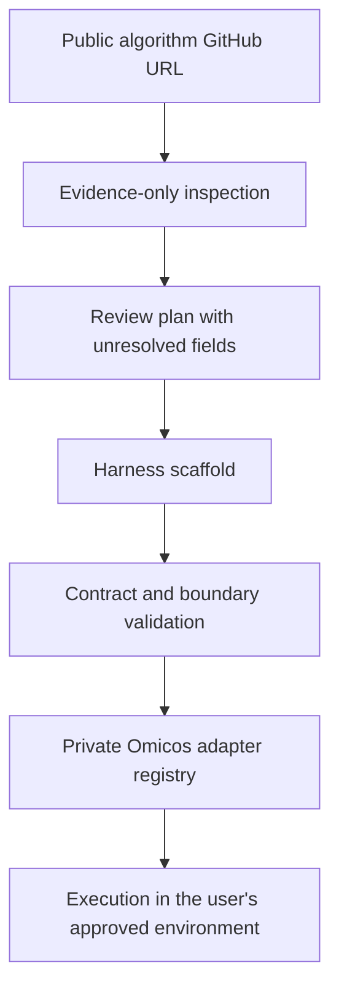

# Omicos Harness Kit

**Public compiler and scaffold for Omicos-compatible algorithm harnesses.**

This repository lets a user provide a public algorithm package URL and produce a reviewable adapter bundle: an input/output contract, a provenance manifest, an agent/skill scaffold, a validation report, and an optional local installation bundle.

The repository deliberately publishes a **public compatibility layer**, not the Omicos product. The private Omicos side remains responsible for runtime execution, agent orchestration, catalog registration, internal MCP wiring, policy enforcement, and deployment review.

## What this repository does



- Parses and records the source URL, requested name, license status, and inspection policy.
- Generates a neutral `agent-harness/omicos` bundle without copying the algorithm source.
- Uses explicit JSON contracts for requests, results, reproducibility, and provenance.
- Fails closed on missing evidence, unsafe paths, secret-like material, and public/private boundary violations.
- Keeps unresolved algorithm semantics as `TODO` or `UNRESOLVED`; a GitHub URL is not treated as proof of an input format or scientific behavior.

## What this repository does not contain

- Omicos runtime, private catalog, internal scheduler, internal MCP implementation, proprietary prompts, private schemas, deployment credentials, or private file paths.
- Any third-party algorithm source code.
- A claim that a generated bundle is deployed to a production Omicos environment.

The generated bundle is an **adapter scaffold**. It becomes a working harness only after a human or an authorized agent fills the documented contract fields from the algorithm's public documentation and validates them in an isolated environment.

## Quick start

```bash
python -m venv .venv
. .venv/bin/activate
python -m pip install -e .

# 1. Produce an evidence-only inspection plan.
ohf inspect https://github.com/StatBiomed/UniTVelo --output inspection.json

# 2. Generate a neutral harness bundle. The command never clones or executes the source.
ohf init \
  --repo https://github.com/StatBiomed/UniTVelo \
  --name unitvelo \
  --output unitvelo-harness

# 3. Review and fill TODO fields, then validate.
ohf validate unitvelo-harness

# 4. Create a portable public bundle for transfer to an authorized private workspace.
ohf package unitvelo-harness --output unitvelo-harness.tar.gz
```

The executable name is `ohf` (without a space). Correct copyable form:

```bash
ohf inspect https://github.com/StatBiomed/UniTVelo --output inspection.json
```

If a rendered line separates the letters, type `ohf` as one word.

## Generated bundle

```text
unitvelo-harness/
├── harness-manifest.json
├── README.md
├── agent-harness/
│   └── omicos/
│       ├── agents/unitvelo_analyst.md
│       └── skills/unitvelo/
│           ├── SKILL.md
│           ├── contracts/reproducibility.v1.json
│           ├── references/input-contract.md
│           ├── references/interpretation.md
│           ├── schemas/request.schema.json
│           ├── schemas/result.schema.json
│           └── scripts/run_adapter.py
└── validation/
    └── public-boundary.json
```

`run_adapter.py` is deliberately a dry-run adapter until the user records a reviewed command or Python entry point. It does not guess how an arbitrary package consumes data, and it does not execute a source repository merely because a URL was supplied.

## Security boundary

The inspection workflow treats repository text, README files, issue content, package metadata, and examples as untrusted input. The default path is metadata and documentation inspection only. It does not execute `setup.py`, build hooks, post-install scripts, notebooks, or arbitrary package code.

If a user explicitly requests a smoke test, the test belongs in a rootless container or a disposable virtual environment with:

- no network;
- read-only source;
- a workspace-only output directory;
- a CPU, memory, and wall-clock limit;
- no credentials or inherited secret environment variables.

See [SECURITY.md](SECURITY.md) and [docs/public-private-boundary.md](docs/public-private-boundary.md).

## Contract versioning

The public contract is versioned independently from any private Omicos implementation. A private deployment may accept a contract version only after its own review. See [CONTRACT_VERSIONING.md](CONTRACT_VERSIONING.md).

## License

The kit and its original templates are released under Apache-2.0. Generated bundles must preserve the third-party algorithm's own license and attribution. See [LICENSE_POLICY.md](LICENSE_POLICY.md).
